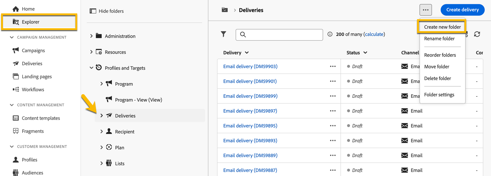
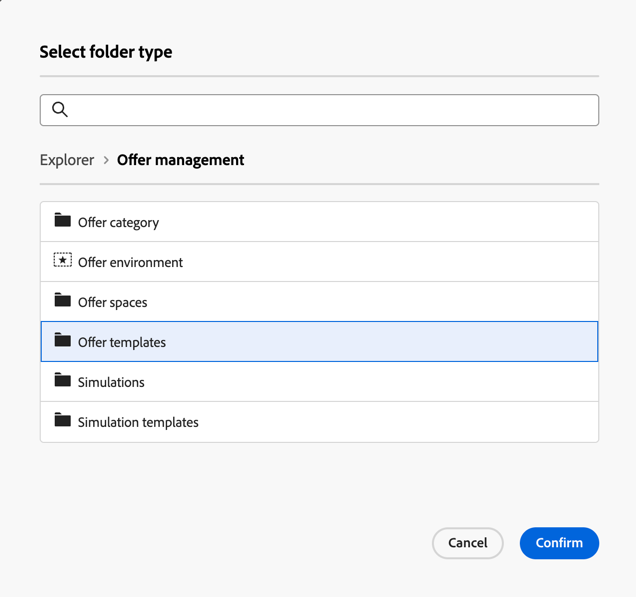

# 创建和管理文件夹

在Adobe Campaign中，您可以创建新文件夹来管理导航树。 在 **[!UICONTROL 资源管理器]**&#x200B;中，转到您想要创建新文件夹的文件夹。

在&#x200B;**[!UICONTROL ...]**&#x200B;按钮下，选择&#x200B;**[!UICONTROL 创建新文件夹]**。

{zoomable="yes"}

当你创建一个新文件夹时，默认情况下，文件夹类型是父级文件夹的类型。\
在该示例中，会在&#x200B;**[!UICONTROL 投放]**&#x200B;文件夹中创建一个子文件夹。

{zoomable="yes"}

您可以更改文件夹类型，方法是单击“文件夹类型”图标，然后从显示的列表中选择一种类型。

{zoomable="yes"}

单击&#x200B;**[!UICONTROL 确认]**&#x200B;按钮设置文件夹类型。

要创建没有特定类型的文件夹，请选择&#x200B;**[!UICONTROL 通用文件夹]**&#x200B;类型。

在Adobe Campaign控制台中，[此处](https://experienceleague.adobe.com/zh-hans/docs/campaign/campaign-v8/config/configuration/folders-and-views)介绍了创建和管理文件夹的流程。 您还可以设置文件夹的权限。 [了解详情](https://experienceleague.adobe.com/zh-hans/docs/campaign/campaign-v8/admin/permissions/folder-permissions)。