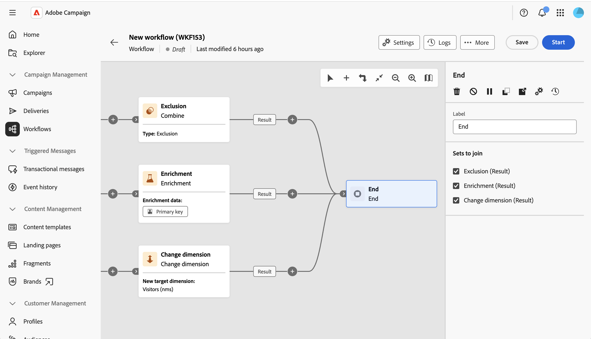

# 终止 {#end}

>[!CONTEXTUALHELP]
>id="acw_orchestration_end"
>title="结束活动"
>abstract="您可以使用&#x200B;**结束**&#x200B;活动以图形方式标记工作流的终点。 当存在多个入站过渡时，请使用&#x200B;**“设置加入”**&#x200B;部分来选择要连接到该活动的过渡。"

>[!CONTEXTUALHELP]
>id="acw_orchestration_end_sets"
>title="要连接的集合"
>abstract="选中您希望作为&#x200B;**结束**&#x200B;活动入站过渡进行连接的上游活动。 随后，所选活动将连接到&#x200B;**结束**&#x200B;活动。 仅当有多个可连接到该活动的入站过渡时，才会显示此部分。"

>[!CONTEXTUALHELP]
>id="acw_orchestration_signal"
>title="外部信号"
>abstract="用于“结束”活动参数中“外部信号”部分的占位符。 仅适用于编排的营销活动。 请勿删除"

**End**&#x200B;活动是&#x200B;**流量控制**&#x200B;活动。 它允许您以图形方式标记工作流的结尾。 此活动是可选的。

当有多个集客过渡可用时，活动支持多个集客过渡。

在&#x200B;**设置为加入**&#x200B;部分中，检查您希望作为&#x200B;**结束**&#x200B;活动的集客过渡连接的以前的活动。 然后，所选活动将链接到工作流画布中的&#x200B;**End**。

